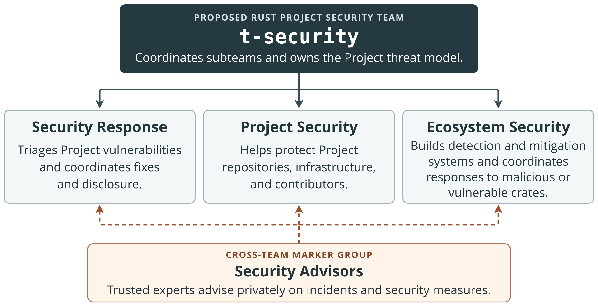

- Feature Name: `security_team`
- Start Date: 2026-11-20
- RFC PR: [rust-lang/rfcs#4032](https://github.com/rust-lang/rfcs/pull/4032)
- Rust Issue: [rust-lang/rust#0000](https://github.com/rust-lang/rust/issues/0000)

## Summary
[summary]: #summary

This RFC establishes a new `security` team under `launching-pad`, with three subteams (`security-response`, `project-security`, `ecosystem-security`) and a private `security-advisors` pool. It does so by defining the charters of each team, including a first charter for the existing `security-response` team, which does not currently have one.

## Motivation
[motivation]: #motivation

Today, we have `wg-security-response`. They have a good handle on incident response. However, they are focused on *reactive* security.

Security response is important and deserves a working group in its own right. But, as we see an increase in the number and severity of security incidents (most recently [arrayref](https://blog.rust-lang.org/2026/08/20/supply-chain-attack-on-arrayref/)), there is a risk of excessive strain on the security response team. We also need to make investments in our forward security posture.

Security engineers with the Rust Foundation are already doing some interesting and promising things on the proactive security front: typosquatting checks, dependency graph analysis, and various detection systems. But, it should be easier for Project members to participate in or build on this work.

Similarly [we have goals to apply crates.io security controls](https://goals.rust-lang.org/2026/crates-io-supply-chain-hardening.html) that will ultimately rely on some amount of consensus since they make opinionated choices. And, some of these choices will need to be semi-private given the "cat and mouse" of security controls. So, having a team of people that can be delegated to make these decisions, under a more broadly agreed-upon framework, seems important.

The charters of the `security` team and its subteams will be formed by the Reference-level explanation part of this RFC. They will be located in the repository of the `security` team, once created. Significant changes to the charters that would impact the scope of other teams, or go beyond the spirit of the initial RFC, will require a new RFC directed to `t-leadership-council`. Other changes to the charters, including creating new subteams that do not impact the scope of other teams, will be handled internal to `security`.

## Guide-level explanation
[guide-level-explanation]: #guide-level-explanation



The `security` team is a thin coordination layer over three working subteams and a private advisory pool.

### `security`

Coordinate the Rust Project's security work across its subteams, act as an entry point for people who want to get involved in security, and keep track of the big picture of the Project's overall security posture (reactive, proactive, and ecosystem-facing).

The top-level team is intentionally thin. Beyond owning and integrating the Project threat model, it does not do the hands-on security work itself; that happens in the subteams. Its job is coordination, routing, and representation.

`security` starts with three working subteams. See each subteam's charter for more information.

- security-response - reactive, Project-internal - [charter](#security-response-team-charter)
- project-security - proactive, Project-internal - [charter](#project-security-team-charter)
- ecosystem-security - crates.io crates and ecosystem - [charter](#ecosystem-security-team-charter)

### `security-response`

Triage and respond to incoming vulnerability reports for the Rust Project, coordinate the development and disclosure of fixes, and maintain the Project's ability to respond to security incidents in a timely, confidential, and trustworthy manner.

The team is the reactive arm of the Project's security programs. It handles reports that arrive at `security@rust-lang.org` and drives them to resolution and public disclosure.

The team is intentionally *not* responsible for proactive security work or for wider ecosystem security beyond narrow situations. Those are the scope of the sibling `project-security` and `ecosystem-security` teams under the `security` umbrella.

### `project-security`

Proactively protect Project-owned repositories and infrastructure and improve the forward security posture of Rust Project contributors. Success for this team means that fewer incidents ever reach `security-response`.

The team produces guidance, tooling, training, and threat-model input that Project teams and contributors are encouraged to adopt, and works alongside t-infra to harden the Project's own resources.

This is the complement to `security-response`: response is reactive, project-security is preventive. Both concern the Project's own systems (as opposed to `ecosystem-security`, which focuses primarily on the wider crates.io ecosystem).

### `ecosystem-security`

Improve the security posture of the wider Rust ecosystem, including crates published on crates.io, and other non-Rust Project software.

This spans proactive work (tooling, detection, information feeds, community guidance) and response work (coordinating action on malicious or vulnerable crates).

To accomplish these goals, the team will consider the health of ecosystem maintainers and burn-out avoidance both of team members and ecosystem maintainers as a key strategic consideration in all approaches.

### `security-advisors`

A marker team of trusted people in a private Zulip channel, `security-advisors`. This channel acts as a rendezvous point for security operators to reach contributors from across Rust Project teams — t-compiler, t-infra, crates.io, cargo, libs, lang, the Foundation, etc. — and individuals with relevant expertise. This allows operators to pull people into private response threads quickly, without widening an embargo to a whole team.

The channel also offers an opportunity to privately seek feedback and a thumbs up on whether security measures meet Project norms and published policies. This is necessary because security efforts involve some amount of cat-and-mouse tactics where public discussion of methods undermines efficacy.

The pool is modeled on [`funding-advisors`](https://github.com/rust-lang/team/blob/master/teams/funding-advisors.toml). [Proposed initial members](#security-advisors-team-definition).

## Reference-level explanation
[reference-level-explanation]: #reference-level-explanation

### Security Team Charter
[security-team-charter]: #security-team-charter

#### Mission

Coordinate the Rust Project's security work across its subteams, act as an entry point for people who want to get involved in security, and keep track of the big picture of the Project's overall security posture (reactive, proactive, and ecosystem-facing).

The top-level team is intentionally thin. Beyond owning and integrating the Project threat model, it does not do the hands-on security work itself; that happens in the subteams. Its job is coordination, routing, and representation.

#### How does this further the Rust Project goals?

Security work in the Project is currently spread across security-response, Rust Foundation security engineers, RustSec maintainers, and t-infra, with no single place that connects them or that a newcomer can approach. As the number and severity of supply-chain incidents grows (e.g. [arrayref](https://blog.rust-lang.org/2026/08/20/supply-chain-attack-on-arrayref/), [spearphishing attacks on Project members](https://blog.rust-lang.org/2026/09/17/targeted-attacks/)), the Project benefits from a team that can coordinate these efforts and surface issues and needs to the relevant teams. It also offers an on-ramp for new contributors.

#### Responsibilities & Commitments

##### Decision Maker

The top-level team is the decision maker on:

- Its own internal coordination: meeting cadence, how subteams keep each other informed, and how cross-subteam questions are routed.
- Proposing the creation, naming, and scope boundaries of subteams within `security`.
    - As a team under `launching-pad`, creating or re-scoping subteams is proposed to the Council/parent team for approval; the team does not have authority to create teams on its own.
- Which cross-cutting security needs to surface (e.g. to the Council, to the Foundation for funding, or to owning teams via the Project Goals process) and how to represent them.
- The Project threat model: the top-level team is its single owner. It decides the model's overall structure and integrates the components maintained by each subteam.

It is explicitly not the decision maker on any other team's purview: infrastructure, crates.io, and cargo decisions remain with those teams.

##### Accountable for results

The team is primarily responsible for coordination:

- Running the coordination touchpoints between subteams.
- Maintaining the team's public-facing "how do I get involved in Rust security?" entry point.
- Keeping the integrated Project threat model current: collecting each subteam's component and connecting them into one up-to-date model.
- Surfacing and escalating gaps, i.e. noticing when the subteams collectively leave part of the intended security scope unowned, and raising it to the Council/parent team.

It is explicitly not accountable for the subteams' actual outcomes (incident response times, ecosystem coverage, hardening adoption).

##### Responsible for work

Hands-on work is done by the subteams, not here. The top-level team's own "work" is limited to:

- Running coordination touchpoints between subteams.
- Highlighting cross-cutting security needs and, where the team chooses, helping the Foundation and funding team seek funding for security work (including work that mostly happens in other teams, e.g. build-script sandboxing).
- Maintaining the team's public-facing "how do I get involved in Rust security?" entry point.
- Integrating the subteams' threat-model components into the single Project threat model

##### Consulted for input

The team should be consulted on:

- Cross-team decisions with broad security implications where no single subteam is the obvious owner.
- Proposals to fund, staff (e.g. Maintainers in Residence), or restructure security work in the Project.

##### Informed for awareness

The team should be informed of significant security-relevant activity in any subteam or adjacent team (major hardening initiatives, ecosystem takedowns, incidents) so it can keep the overall picture current and keep subteams in sync **but only at a post-disclosure / non-embargoed level of detail.**

Because the top-level team has open membership, embargoed incident details, in-progress advisories, and any secrets remain confined to the relevant subteam's access-controlled channels and are never shared into the coordination team or `#security-chat`.

#### Subteams

`security` starts with three working subteams. See each subteam's charter for more information.
- security-response - reactive - [charter](#security-response-team-charter)
- project-security - proactive, Project-internal - [charter](#project-security-team-charter)
- ecosystem-security - crates.io crates and ecosystem - [charter](#ecosystem-security-team-charter)

#### security-advisors

The team also includes an advisory pool of trusted people in a private Zulip channel, `security-advisors`. This channel acts as a rendezvous point for security operators to reach contributors from across Rust Project teams — t-compiler, t-infra, crates.io, cargo, libs, lang, the Foundation, etc. — and individuals with relevant expertise. This allows operators to pull people into private response threads quickly, without widening an embargo to a whole team.

The channel also offers an opportunity to privately seek feedback and a thumbs up on whether security measures meet Project norms and published policies. This is necessary because security efforts involve some amount of cat-and-mouse tactics where public discussion of methods undermines efficacy.

The pool is modeled on [`funding-advisors`](https://github.com/rust-lang/team/blob/master/teams/funding-advisors.toml). [Proposed initial members](#security-advisors-team-definition).

#### How does this team make decisions?

By consensus among its members, who include the team's lead(s), once determined, plus at least one delegate from each subteam.

Most substantive decisions belong to a subteam or another team; where a public Project decision is needed the team uses the standard RFC / FCP process.

New members of `security-advisors` are nominated by members of this team or its subteams, then approved by this team's lead(s).

#### What work is not specifically part of this team's remit?

- Doing incident response, proactive Project hardening, or ecosystem tooling itself. Those belong to subteams.
- Making decisions inside crates.io / cargo / infra purviews. The team can surface needs and offer help, but does not decide for those teams.

#### Team Processes

##### Contact Point

General discussion happens in the `#security-chat` Zulip channel.

##### Team Membership

Members: the lead(s) once determined, at least one delegate from each subteam (so that each subteam stays looped in), and anyone else who wants to help coordinate. Membership is intended to stay small.

Members are expected to:

- Represent their subteam's status and needs in coordination, and carry information back.
- Help route interested contributors and surface cross-cutting needs.

##### How is team membership managed?

Each subteam nominates its delegate(s). Additional coordinating members join by consensus of the team.

##### Where does this team work?

Coordination happens in the `#security-chat` Zulip channel and, as needed, in the `security` team's repository/tracker.

### Security Response Team Charter
[security-response-team-charter]: #security-response-team-charter

#### Mission

Triage and respond to incoming vulnerability reports for the Rust Project, coordinate the development and disclosure of fixes, and maintain the Project's ability to respond to security incidents in a timely, confidential, and trustworthy manner.

The team is the reactive arm of the Project's security programs. It handles reports that arrive at `security@rust-lang.org` and drives them to resolution and public disclosure.

The team is intentionally *not* responsible for proactive security work or for wider ecosystem security beyond narrow situations. Those are the scope of the sibling `project-security` and `ecosystem-security` teams under the `security` umbrella.

#### How does this further the Rust Project goals?

Users and downstream distributors need to trust that vulnerabilities in the Rust toolchain and the Project's own repositories are handled responsibly: assessed quickly, fixed privately where appropriate, disclosed responsibly, and communicated clearly.

A dedicated response team ensures there is always a known, staffed path for security reporters to reach the Project. It also allows us to fine tune and document our response processes to best handle new incidents.

#### Responsibilities & Commitments

##### Decision Maker

The team is the final decision maker on:

- Whether an incoming report constitutes a security vulnerability in scope for the Project, and its severity assessment.
- The handling and disclosure plan for a given report: embargo timelines, the disclosure date, whether a private/pre-notified release is warranted, and coordination with reporters and downstream distributors (e.g. `distros@`, `oss-security@`).
- The content and timing of security advisories and announcements published through Project channels (security mailing list, blog, users.rust-lang.org, GitHub Security Advisories).
- The contents of the incident-response component of the Project threat model.
    - The integrated threat model is owned by the top-level `security` team.
    - security-response is responsible for the response/incident portion and brings it to the top-level team.

Fixes to the underlying vulnerable code are ultimately decided by the team that owns that code (e.g. the compiler, libs, cargo, or crates.io teams). security-response coordinates and is accountable for the response process around them, but does not override those teams' technical decisions.

##### Accountable for results

The team is accountable for:

- Every report sent to `security@rust-lang.org` receiving a timely acknowledgement and being driven to a resolution (fix + disclosure, handoff to ecosystem-security and crates.io teams, or a documented decision that no action is needed).
- Coordinated disclosure happening on the agreed timeline, including the required upstream notifications for medium-or-higher severity issues.
- The incident-response component of the Project threat model being kept current.
- The security response process itself being documented and functional (see the [wg-security-response repo](https://github.com/rust-lang/wg-security-response)), including custody of the security team's signing key and access to the shared secrets store.

##### Responsible for work

The team members do the hands-on work of:

- Monitoring and triaging the `security@rust-lang.org` inbox (including decrypting GPG-encrypted reports).
- Passing `security@rust-lang.org` reports related to ecosystem incidents to `ecosystem-security` processes.
- Setting up per-incident private Zulip streams and running the investigation and response with the reporter.
- Coordinating the fix, arranging point releases/patches, and distributing patch files (signed with the security key).
- Writing and publishing advisories and announcements across the required channels, and sending the pre-disclosure notifications to `distros@lists.openwall.com` / `oss-security@lists.openwall.com`.
- Authoring and maintaining the incident-response component of the Project threat model, and feeding it to the parent team.

##### Consulted for input

The team should be consulted on:

- Changes to Project infrastructure, release processes, repository policies, or security scope that would materially affect the Project's ability to respond to or contain a security incident
- Sibling `security` subteams' proactive work where it intersects with incident handling (e.g. `project-security` guidance on repo hardening, `ecosystem-security` handling of malicious/vulnerable crates that may generate reports into this team's inbox).
- Designs of security-relevant features by owning teams (e.g. crates.io trusted publishing, cargo build-script sandboxing) where the response team's incident experience is relevant.
- ecosystem-security handling of security incidents for projects outside of `rust-lang`
    - This is a desired state, but initially, security-response is responsible for leading the handling of high-impact ecosystem vulnerabilities according to its existing processes, until ecosystem-security has the process and capacity to handle them.

##### Informed for awareness

The team should be informed of:

- Security-relevant changes shipping in `rust-lang`/`rust-lang-nursery` repositories significant enough to warrant mention in release notes or advisories.
- Ecosystem incidents handled by `ecosystem-security` (e.g. malicious-crate takedowns) so that response and ecosystem work stay coordinated even when the response team is not the one acting.

#### How does this team make decisions?

Response decisions are made by team consensus, typically in the private per-incident Zulip stream, given the confidential nature of the work.

#### What work is not specifically part of this team's remit?

- Proactive security of Project properties (GitHub Actions usage policy, CI hardening recommendations, publishing hygiene, spearphishing training): this belongs to `project-security`.
- Wider ecosystem security (RustSec/advisory-db operations, scanning and outreach for crates the Project does not itself depend on, malicious-crate response on crates.io): this belongs to `ecosystem-security`
    - This is the desired end state, but initially security-response remains responsible for high-impact ecosystem incidents, until ecosystem-security has the process and capacity to handle them
    - The exception to this is if a report in ecosystem-security scope happens to arrive through the security-response inbox, in which case security-response is responsible for handing the incident off to ecosystem-security but not following it to completion.
- Building security tooling or detection systems: response consumes such tooling but does not own its development.

#### Team Processes

##### Contact Point

Reports and contact go through security@rust-lang.org per the [Rust security policy](https://www.rust-lang.org/policies/security). Do not open public issues for vulnerabilities.

##### Team Membership

Team members are expected to:

- Be reachable for incident response and share the load of monitoring/triaging the `security@` inbox.
- Handle reports confidentially and follow the documented process (including key handling and coordinated-disclosure obligations).

##### How is team membership managed?

Given the sensitivity of the work (access to embargoed reports, the security signing key, and the shared secrets store), membership changes warrant deliberate onboarding/offboarding, including provisioning and revoking access to those secrets.

These decisions are made via team consensus in private channels.

##### Relationship to the `security` umbrella

This team is the existing Security Response working group. Its team entry in [rust-lang/team](https://github.com/rust-lang/team) is named `security-response` (already under `launching-pad`), while its repo and Zulip presence still carry the older `wg-security-response` name.
This charter uses "security-response" for the team and "wg-security-response" only for those existing artifacts. No rename is proposed here unless current team members prefer it.

This team is proposed to sit as a subteam of the new `security` team (initially under `launching-pad`), alongside `project-security` and `ecosystem-security`.

The team is *invited* to send a delegate to the thin top-level `security` coordination team so that response and proactive work stay in sync. Given the team is small (three members), this is best-effort and optional rather than an obligation.

Any coordination across subteams happens at a non-embargoed level. The private security-advisors Zulip channel offers a venue for sensitive cross-team communication.

##### Where does this team work?

Process documentation lives in [rust-lang/wg-security-response](https://github.com/rust-lang/wg-security-response).

Live incident handling happens in private, per-incident Zulip streams on the [rust-lang Zulip instance](https://rust-lang.zulipchat.com), named `wg-security-response/<incident>`.

General (non-incident) coordination happens in the `#security-chat` Zulip channel and the `WG-security-response` Zulip group.

### Project Security Team Charter
[project-security-team-charter]: #project-security-team-charter

#### Mission

Proactively protect Project-owned repositories and infrastructure and improve the forward security posture of Rust Project contributors. Success for this team means that fewer incidents ever reach `security-response`.

The team produces guidance, tooling, training, and threat-model input that Project teams and contributors are encouraged to adopt, and works alongside t-infra to harden the Project's own resources.

This is the complement to `security-response`: response is reactive, project-security is preventive. Both concern the Project's own systems (as opposed to `ecosystem-security`, which focuses primarily on the wider crates.io ecosystem).

#### How does this further the Rust Project goals?

The recent rise in targeted attacks and supply-chain incidents shows that the Project's own repos, CI, and publishing flows are high-value targets. Today, proactive hardening happens ad hoc (some under t-infra, some via the Foundation).

A dedicated team that develops shared best-practice guidance, training, and enforcement tooling raises the baseline security of Project resources while respecting each owning team's autonomy.

#### Responsibilities & Commitments

##### Decision Maker

The team is the decision maker on:

- The content of its recommendations, guidance, and training (e.g. safe GitHub Actions usage policy, crates.io publishing hygiene, CI hardening advice, "you are a high-value target" anti-spearphishing training).
- The design of any tooling it builds to help teams audit or enforce those recommendations.
- The Project-infrastructure-and-contributors component of the threat model
     - project-security is responsible for authoring and maintaining it
     - Covers both Project-owned infrastructure (repos, CI, publishing) and the forward security posture of Project contributors themselves (contributors as high-value targets, account/credential and device hygiene, spearphishing).
     - The overall threat model is owned by the parent `security` team, but project-security decides the content of its portion.

The team *does not decide* whether other teams adopt its recommendations, and does not hold decision authority over infrastructure, crates.io, or cargo. Adoption is at each owning team's discretion. These are recommendations with supporting tooling, not requirements (per @Mark-Simulacrum's feedback). This mirrors how t-infra already operates with the teams whose systems it touches.

##### Accountable for results

The team is accountable for:

- The existence and upkeep of a set of proactive-security recommendations for Project properties.
- Proposing concrete mitigations to reduce the blast radius of likely failure modes (e.g. credential compromise of an individual Project member) and sharing them with owning teams (primarily t-infra).
- Delivering a security-awareness training program
- Growing a cross-team network of security-oriented Rust Project members, who can guide their peers.

##### Responsible for work

The team members do the work of:

- Writing and maintaining Rust Project guidance/policies for GitHub Actions usage, CI, and publishing hygiene, and building audit/enforcement tooling for them.
- Developing and delivering trainings (anti-spearphishing, high-value-target awareness) and recruiting/mentoring per-team security points of contact.
    - The Rust Foundation will offer funding and logistics support for this work.
- Authoring and maintaining the Project-infrastructure-and-contributors component of the threat model
- Collaborating with t-infra on proactive hardening initiatives (e.g. work in the spirit of crabwatch)

##### Consulted for input

The team should be consulted on:

- Changes to Project CI, repository settings, or publishing flows where a security perspective is valuable.
- Designs of security-relevant Project-infrastructure features by owning teams (t-infra, crates.io, cargo).
- Decisions about moving critical tooling with security implications into rust-lang (e.g. widely-used GitHub Actions)

##### Informed for awareness

The team should be informed of:

- Incidents handled by security-response, so its preventive guidance can learn from real failures.
- Infrastructure changes across the Project with security relevance.

#### How does this team make decisions?

By team consensus; where a public Project decision or a broadly-scoped recommendation is involved, via the standard RFC/FCP process.

#### What work is not specifically part of this team's remit?

- Reactive incident response: belongs to security-response.
- Ecosystem-facing security (crates.io-wide scanning, RustSec, malicious-crate response): belongs to ecosystem-security.
- Owning or operating other teams' infrastructure: project-security only advises and offers tooling.
    - Any hands-on operation of Project repos/CI/publishing happens only under explicit, revocable delegation from the team that owns that surface (primarily **t-infra**, and the relevant repo/org owners for a given repository), with access scope defined and granted by them.
- Building missing security *features* (e.g. trusted-publishing lockdown, build-script sandboxing) — those are for the owning teams (crates.io, cargo)
    - Project-security may help surface the need via Project Goals and other collaboration venues.

#### Team Processes

##### Contact Point

General discussion happens in the `#security-chat` Zulip channel.

##### Team Membership

Members are expected to:

- Contribute to guidance, tooling, training, or threat-model work on a recurring basis.
- Engage with owning teams (especially t-infra) collaboratively, respecting their authority.

##### How is team membership managed?

This will be defined following chartering by initial members.

##### Relationship to the `security` umbrella

A subteam of `security` (initially under `launching-pad`). Expected to send at least one delegate to the top-level coordination team.

##### Where does this team work?

Discussion in the `#security-chat` Zulip channel. It ultimately may create its own subchannel.

### Ecosystem Security Team Charter
[ecosystem-security-team-charter]: #ecosystem-security-team-charter

#### Mission

Improve the security posture of the wider Rust ecosystem, including crates published on crates.io, and other non-Rust Project software.

This spans proactive work (tooling, detection, information feeds, community guidance) and response work (coordinating action on malicious or vulnerable crates).

To accomplish these goals, the team will consider the health of ecosystem maintainers and burn-out avoidance both of team members and ecosystem maintainers as a key strategic consideration in all approaches.

#### How does this further the Rust Project goals?

Rust's value depends heavily on a trustworthy crate ecosystem, but, at the time of writing, ecosystem security is fragmented: RustSec/advisory-db lives outside the Project with maintainers coordinating partially through wg-secure-code, malicious-crate response falls implicitly on the crates.io oncall and Foundation security engineers, and proactive tooling is scattered. Consolidating this into one team gives the ecosystem a coherent home, a sustainable path for response, and an accessible entry point for the growing set of contributors interested in this space.

In the process, this gives us an opportunity to re-examine ecosystem practices around security handling that may or may not be working:
- What kinds of author outreach, if any, make sense as a standard approach? Is it effective in improving remediation? Does it contribute to team member or ecosystem maintainer burnout? Should this team handle initial reachout, or the reporters?
- Is a mixed stream of vulnerabilities and advisories appropriate for downstream consumers?
- How can we scale out our efforts to handle the growing count of potentially significant vulnerabilities which are discovered by LLMs? This includes not only triage but also driving remediation efforts in a way that is consistent with the project's values and doesn't contribute to burnout.

#### Responsibilities & Commitments

##### Decision Maker

The team is the decision maker on:

- The design and roadmap of ecosystem-security tooling and information feeds it owns or maintains (e.g. scanning pipelines, detection heuristics, CI tooling).
- Its own internal division of labor between "response" (handling of malicious or vulnerable crates) and "proactive" (scanning, tooling, feeds).
- The approaches taken for handling of malicious crates, which may include author outreach or publishing advisors.
- The content and publication of security advisories for ecosystem crates (RustSec / advisory-db), once RustSec lives here (contingent on a separate proposal)
- The operations, particularly the operational security practices, of its response subgroup.

The team is **not** the decision maker on crates.io or cargo behavior. Actions taken on crates.io (e.g. removing a malicious crate, acting on ownership) are done only under explicit delegation from the crates.io team, with access granted and revocable by them.

##### Accountable for results

The team is accountable for:

- Ecosystem-security tooling and feeds it commits to remaining maintained and useful to consumers.
- Malicious/vulnerable-crate situations having an owner for the parts within this team's remit: coordinating responses to high-impact malicious or vulnerable crates, which may include reaching out to affected/at-risk authors and publishing advisories. Actioning crates on crates.io (yank/quarantine/delete) stays with crates.io (see "Responsible for work" for more on delegation).
    - The team will set standards for which cases the team will take action on. The team does not assume responsibility for resolving all cases.
    - This is a desired state, but initially, security-response is responsible for this outcome, until ecosystem-security has the process and capacity to handle it
- Ecosystem vulnerability reports and advisories being triaged and published in a timely way (RustSec operations). `[Once RustSec is placed here via separate proposal.]`
- Improving the overall sustainability of the ecosystem's security handling processes, including preventing maintainer burnout

##### Responsible for work

The team members do the work of:

- Authoring and maintaining the ecosystem component of the Project threat model (crates ecosystem / supply-chain threats), contributed to the parent `security` team to include in the broader Project threat model.
- Building and running detection/scanning (e.g. typosquatting checks, dependency-graph analysis, publish-time checks that route suspicious uploads to a manual review queue, continuous scanning of published crates to enrich feeds).
- Creating a response/triage sub-group, rotation, or similar
  - This is a desired state, but initially, security-response is responsible for this outcome, with ecosystem-security consulted for input, until ecosystem-security has the process and capacity to handle it
  - Working out their own delegations for this team, that are compatible with the threat model
  - Setting a limit on the size of the *actively involved* people *for each delegation*
  - **Coordinating** with the crates.io team on clearly-malicious crates, providing evidence and recommendations.
  - Where relevant, author outreach for vulnerable crates.
  - The team starts with no delegated authority on crates.io. Down the road, the crates.io team may choose to delegate some operational authority to this team. If they do, it happens only under an explicit, revocable program that spells out audit logging, review for destructive actions (deletion), and who is accountable.
- Producing consumer-facing security tooling/guidance (e.g. nicer GitHub Actions around cargo audit/deny/vet-style checks)
    - Note that formal Project adoption of external tools is a separate proposal.
- (If the team chooses to establish it) staffing an opt-in, trained ecosystem-security oncall operating under crates.io-delegated access. This needs more design and is explicitly *not* part of the initial chartering request.
- RustSec / advisory-db maintenance and advisory authoring. `[Once RustSec is placed here via separate proposal.]`

##### Consulted for input

The team should be consulted on:

- crates.io / cargo designs with ecosystem-security implications (e.g. trusted publishing, yanking/quarantine semantics, publish-time policy).
- Project decisions about adopting or first-partying ecosystem security tooling.
- Project-internal incidents from security-response that have ecosystem spillover, for instance crates that are owned by `rust-lang`.

##### Informed for awareness

The team should be informed of:

- Relevant Foundation security-engineering work, to align and avoid duplication.

#### How does this team make decisions?

By team consensus, with a clear internal understanding of who leads response vs. proactive work. Advisory publication follows RustSec/advisory-db's existing process; broader Project decisions use the standard RFC/FCP process.

#### What work is not specifically part of this team's remit?

- Project-internal hardening (Project repos/CI/publishing): belongs to project-security.
- Reactive response to vulnerabilities in Project-owned code: belongs to security-response.
- Deciding crates.io / cargo policy or operating their systems outside delegated actions: stays with those teams.
- Formal Project adoption of external tooling (cargo audit/vet/deny, etc.) as governed by Rustlang
    - Individual contribution is fine.
    - This team may raise proposals for adoption of tools to the broader Project.
    - The RustSec/advisory-db placement is an example of tooling that will require a process beyond this team's initial charter.

#### Team Processes

##### Contact Point

`@jlizen` can be point of contact until the team discusses further leadership processes. General discussion happens in the `#security-chat` Zulip channel.

##### Team Membership

Members are expected to:

- Contribute recurring work to advisory operations, tooling/detection, or ecosystem response.
- When acting on crates.io, operate strictly within crates.io-delegated authority and access.

##### How is team membership managed?

This will be defined following chartering by initial members.

##### Relationship to the `security` umbrella, RustSec, and wg-secure-code

- security: ecosystem-security is a subteam of `security` (initially under `launching-pad`), expected to send at least one delegate to the top-level coordination team.
- RustSec: we think it should live in `ecosystem-security` or a new subteam, but whether to move RustSec inside the Project at all will be discussed in a separate RFC which @djc intends to drive following the chartering of `security` and `ecosystem-security`.
- wg-secure-code: almost certainly belongs here, but we want to have further discussions before moving forward.

##### Where does this team work?

Primarily async, on Zulip. We can use the `#security-chat` Zulip channel until the throughput of the channel becomes overwhelming, at which point we can split.

We expect to spin up recurring meetings but need to discuss further first.

RustSec work would continue in the advisory-db / rustsec repositories.

### `security-advisors` team definition
[security-advisors-team-definition]: #security-advisors-team-definition

Proposed `rust-lang/team` entry for `security-advisors`:

```toml
name = "security-advisors"
subteam-of = "security"

[people]
leads = []
members = [
    "Manishearth",
    "emilyalbini",
    "cuviper",
    "Mark-Simulacrum",
    "jlizen",
    "LawnGnome",
    "m-ou-se",
    "teor2345",
    "djc",
    "walterhpearce",
    "amousset",
    "alex",
    "tarcieri",
    "Eh2406",
    "nia-e",
    "obi1kenobi",
    "joshlf",
    "jdno",
    "marcoieni",
    "ubiratansoares",
    "davidtwco",
    "saethlin",
    "Turbo87",
    "clarfonthey",
    "joshtriplett"
]
alumni = []

[website]
name = "Security advisors"
description = "A small group of members cutting across Project teams that are available for private consultation for security concerns."

[[zulip-groups]]
name = "T-security-advisors"

[[zulip-streams]]
name = "security/with-advisors"
extra-teams = [
    "security-response",
    "foundation-board-project-directors",
    "crates-io-admins",
    "crates-io-on-call",
    "leadership-council",
    "infra-admins",
]
```

## Rationale and alternatives
[rationale-and-alternatives]: #rationale-and-alternatives

### Alternative: broaden `security-response` instead of creating a new team

Rather than a new umbrella team, the existing `security-response` working group could take on proactive and ecosystem security work as well. But, as we see an increase in the number and severity of security incidents, there is a risk of excessive strain on the security response team. As @Manishearth put it, "don't make the people driving security response manage all security work"; security-response shouldn't _become_ T-security.

This leaves the obvious question of why not just bring more people into `security-response`. At the end of the day, `security-response` didn't sign up for this, and incident response is a different way of working than proactive measures. People can already do cross-cutting things in `security`, so let's not mess up what's working by trying to refactor the existing team.

### Alternative: a single flat `security` team

Rather than a thin top-level team with subteams, all security work could live in one flat team. But, we want to optimize for doing work, and grouping related efforts allows higher communication bandwidth among the people working on them. A single team covering incident response, Project hardening, and the ecosystem would lose that. The top-level team only does what needs a cross-cutting view: coordination, routing, representation, and the integrated threat model.

### Why a private `security-advisors` pool rather than public discussion?

Security efforts involve some amount of cat-and-mouse tactics where public discussion of methods undermines efficacy. They also involve individual people, in some cases making mistakes around security, who are not appropriate to bring into the public view. The channel allows operators to pull people into private response threads quickly, without widening an embargo to a whole team. It also offers an opportunity to privately seek feedback and a thumbs up on whether security measures meet Project norms and published policies.

### Why `launching-pad` rather than a top-level team?

Adding a top-level team has broader implications around governance, including Council representation. We want to wait to see how the team operates in practice, and what level of participation we see, before raising that question. Notably, there might be further changes, such as incorporating RustSec, that meaningfully change the team's scope. We propose to revisit this question in 6 months.

### Why not include RustSec now?

RustSec / advisory-db lives outside the Rust Project, with its maintainers coordinating partially through wg-secure-code. We think it should live in `ecosystem-security` or a new subteam, but we first need to discuss moving RustSec inside the Project at all. That deserves its own RFC discussion rather than overloading this one.

### Why treat maintainer burnout as a strategic consideration?

It is not sufficient to triage vulnerabilities; we also need a way of shipping fixes. That is not possible today with the amount of pressure on upstream maintainers. So it is critical to this team's goals that we find alternatives that do not burn out maintainers. We also need to consider responder burnout: RustSec maintainers are stretched thin, and `security-response` is a small team today.

### Why recommendations rather than requirements?

Existing teams own these areas and are the subject matter experts on them. The Rust Project does not charter teams that reduce other teams' scope without explicit consensus on both sides. We're best off operating in an advisory way, and perhaps seeing over time what a team might prefer to hand off.

### Why not start off with crates.io delegating security work to ecosystem-security?

Finding the right delegation model takes care and consensus seeking, even if the crates.io team is not interested in being the frontline for security issues in the long term. The team therefore starts with no delegated authority on crates.io.

### Why does security-response initially keep primary responsibility for ecosystem incidents?

security-response is handling high-impact ecosystem incidents today, and we need to transition mindfully to avoid dropping the ball. security-response therefore remains responsible for them until ecosystem-security has the process and capacity to handle them.

### Why does the top-level team own the threat model?

Threat models work best when there is one owner. The top-level team is also responsible for creating new subteams, which will be informed by the threat model.

### Why an open top-level team alongside confidential subteams?

We care about having an accessible front door for people who want to get involved in Rust security, and a place for external sponsors and collaborators to plug in to. The top-level team shouldn't be discussing sensitive topics, so we optimize for openness and transparency until there is a reason to segment. Embargoed incident details, in-progress advisories, and any secrets remain confined to the relevant subteam's access-controlled channels and are never shared into the coordination team or `#security-chat`.

## Unresolved questions
[unresolved-questions]: #unresolved-questions

The following are left open in the charters and are expected to be resolved by the initial members after the teams exist, rather than through this RFC:

- Lead / point person for `project-security`.
- How membership is managed for `project-security` and `ecosystem-security` (the latter in coordination with RustSec maintainers).
- Decision-making process for `ecosystem-security`, to be confirmed with initial members and with RustSec maintainers.
- RustSec: we think it should live in `ecosystem-security` or a new subteam, but whether to move RustSec inside the Project at all will be discussed in a separate RFC which @djc intends to drive following the chartering of `security` and `ecosystem-security`.
- wg-secure-code: almost certainly belongs under `ecosystem-security`, but we want to have further discussions before moving forward.
- Whether the existing `wg-security-response` repo and Zulip presence are renamed to `security-response`. No rename is proposed here unless current team members prefer it.

## Future possibilities
[future-possibilities]: #future-possibilities

- Making `security` a top-level team depending on level of engagement.
- An opt-in, trained ecosystem-security oncall operating under crates.io-delegated access. This needs more design and is explicitly *not* part of the initial chartering request.
- The crates.io team may choose to delegate some operational authority to `ecosystem-security`. If they do, it happens only under an explicit, revocable program that spells out audit logging, review for destructive actions (deletion), and who is accountable.
- Formal Project adoption of external tooling (cargo audit/vet/deny, etc.). This team may raise proposals for adoption of tools to the broader Project.
